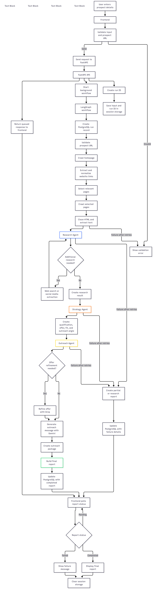

# Prospect AI

An AI-powered prospect intelligence agent that researches prospects through their websites, analyzes their business, evaluates their qualification, and generates personalized outreach messages alongside a comprehensive prospect report.

# Problem

For freelancers, solo professionals, and small agency owners who rely on direct outreach to acquire clients, prospecting can be a time-consuming process.

Manually reviewing potential clients' websites, determining whether they qualify based on the services offered, identifying relevant opportunities, and writing personalized outreach messages requires significant time and effort. 

Repeating this process for every prospect makes consistent and scalable outreach challenging.

# Approach

Prospect AI streamlines this process through an AI-powered prospect research and qualification workflow.

Users submit a prospect's website URL, and the system processes it through the following stages:

1. **Website Extraction:** Extracts relevant information and content from the prospect's website.
2. **Content Processing:** Cleans and structures the extracted content for downstream analysis.
3. **AI Research & Analysis:** Analyzes the prospect's business, services, and relevant business context.
4. **Prospect Qualification:** Evaluates the prospect's suitability and develops an outreach strategy based on the findings.
5. **Personalized Outreach Generation:** Generates a personalized outreach message based on the developed strategy and communication channel selected by the user.
6. **Report Generation:** Produces a comprehensive, downloadable prospect report containing the research findings, qualification assessment, strategy, and generated outreach message.

# Architecture

Prospect AI follows an asynchronous, workflow-driven architecture built around FastAPI, LangGraph, and PostgreSQL. The system separates request handling from AI execution, allowing prospect research and report generation to run in the background while the frontend tracks execution progress.

## AI Prospect End-to-End Workflow

## Architecture Overview

- **Frontend:** Built with vanilla HTML, CSS, and JavaScript, and hosted on Vercel. It provides the user interface for submitting prospect information and retrieving generated reports.
- **Backend:** FastAPI handles API requests, validates inputs, generates unique run IDs, and manages asynchronous workflow execution.
- **AI Orchestration:** LangGraph combined with custom Python workflows coordinates the end-to-end prospect research pipeline. LLMs handle tool selection, while application logic controls workflow execution, conditional transitions, and retries.
- **Database:** PostgreSQL manages execution state and captures run metadata, including prospect URLs, execution status, timestamps, generated reports, error details, failed phases, and token usage across Gemini and Groq.
- **Deployment:** The frontend is deployed on Vercel, while the backend runs in Docker containers on an Azure Virtual Machine.
- **Observability:** LangSmith provides workflow tracing and monitoring, complemented by application-level logging for execution visibility and debugging.

## Workflow Execution

The AI pipeline follows a sequential, conditional workflow:

1. **Website Extraction:** Fetches the prospect's homepage, discovers relevant website links, selects useful pages such as About, Services, Pricing, and Contact, and extracts their content.
2. **Data Cleaning:** Removes unnecessary HTML elements, converts extracted HTML into clean text, and prepares structured content for analysis.
3. **Research Workflow:** Analyzes the prospect's business, services, industry, location, contact information, people, and business type. Conditionally invokes social bio tool or web search tool
4. **Missing Information Check:** Evaluates whether additional information is required. If necessary, the LLM can invoke the additional research tool to gather missing information.
5. **Strategy Workflow:** Evaluates prospect qualification, generates qualification reasoning, and develops an appropriate offer and outreach strategy.
6. **Outreach Workflow:** Generates a personalized outreach message based on the developed strategy and the communication channel selected by the user.
7. **Offer Refinement:** Conditionally invokes the offer refinement tool when further refinement is required.
8. **Final Report Generation:** Combines the research findings, qualification assessment, strategy, and outreach message into a comprehensive prospect report.

## Workflow-Level Retry & Fallback Handling

Prospect AI implements workflow-level retries with a maximum of three attempts per workflow. When a workflow exhausts its attempts, LangGraph follows a stage-specific fallback path to preserve successfully completed work.

| Failed Workflow | Fallback Behavior |
|---|---|
| Data Cleaning | Routes directly to the workflow's END node. |
| Research | Generates a research-only report using get_research_report. |
| Strategy | Generates a partial report using get_partial_report. |
| Outreach | Generates a partial report using get_partial_report. |

The fallback behavior depends on the stage at which execution fails:

- **Research Failure:** Produces a research-only report containing the available research findings.
- **Strategy or Outreach Failure:** Produces a partial report containing successfully completed earlier stages.
- **Data Cleaning Failure:** Terminates the workflow without proceeding to downstream stages.

These fallback paths allow the LangGraph pipeline to exit through its normal execution flow while preserving available results.

After workflow execution, the backend receives the pipeline result and calls update_complete_record(...) to persist the execution outcome in PostgreSQL.

## Request Lifecycle

1. The frontend submits the prospect URL and offer details to POST /get_input.
2. FastAPI validates the request, generates a unique run_id, and schedules the background task.
3. The API immediately responds with the run_id and queued status.
4. The background task creates a PostgreSQL execution record and starts the LangGraph pipeline.
5. The pipeline executes the extraction, cleaning, research, qualification, strategy, and outreach stages.
6. Execution results and status updates are captured in PostgreSQL, while LangSmith and application logging provide observability.
7. The frontend polls GET /get_report/{run_id} to retrieve execution status and results.
8. Once processing finishes, the API returns the completed report or failure information. Available partial results are retained when execution fails.

## Tech Stack

Prospect AI is built using a Python-based backend, LangGraph orchestration, multiple LLM providers, and PostgreSQL for execution-state management.

| Category | Technology | Purpose |
|---|---|---|
| Frontend | HTML, CSS, JavaScript | User interface and API communication |
| Backend | Python, FastAPI | REST API and asynchronous request handling |
| Validation & Configuration | Pydantic, pydantic-settings | Request validation, schemas, and environment configuration |
| AI Orchestration | LangGraph, Custom Python Workflows | Workflow coordination, conditional execution, and retry handling |
| LLM Provider | Groq — openai/gpt-oss-120b | Prospect research, strategy generation, and web-search reasoning |
| LLM Provider | Google Gemini — gemini-3.5-flash-lite | Additional prospect research and outreach generation |
| LLM Fallback | Google Gemini — gemini-3.1-flash-lite | Automatic fallback when the primary Gemini model fails |
| Web Extraction | Crawl4AI | Website crawling and page fetching |
| HTML Processing | BeautifulSoup4, lxml | HTML parsing and content cleaning |
| HTTP Requests | Python Requests | Basic URL reachability checks |
| Browser Automation | Playwright, Chromium | Browser-based website extraction |
| Database | PostgreSQL | Execution-state tracking and report persistence |
| Database Driver | Psycopg | PostgreSQL connectivity |
| Database Migrations | Alembic | Database schema migrations |
| Monitoring & Tracing | LangSmith | LLM workflow tracing and observability |
| Application Logging | Python Logging | Application-level execution logs and debugging |
| API Rate Limiting | SlowAPI | Request rate limiting |
| Deployment | Docker, Azure VM | Containerized backend deployment |
| Frontend Hosting | Vercel | Frontend hosting |

### Runtime Environments

- Local Development: Python 3.13.7
- Docker Runtime: Python 3.12

### Web Extraction & Research

- Crawl4AI: Website crawling, browser-based page fetching, and content extraction.
- Playwright / Chromium: Underlying browser automation infrastructure used by Crawl4AI.
- BeautifulSoup4 / lxml: HTML parsing and content cleaning.
- Python Requests: Basic URL reachability checks.
- External Search Results: Used by the Groq-powered research workflow to gather information from public forums and credible articles.
- Gemini Additional Research: Performs supplementary prospect research when the initial analysis identifies missing information.

## Key Technology Choices

- **LangGraph:** Provides structured orchestration for sequential workflows, conditional transitions, and stage-level retry and fallback handling.
- **Multiple LLM Providers:** Groq and Google Gemini handle different AI tasks, allowing the system to use different models for research, strategy, and outreach generation.
- **Crawl4AI:** Handles website crawling and relevant page extraction instead of relying exclusively on basic HTTP requests.
- **PostgreSQL:** Provides persistent execution tracking, report storage, and workflow state management.
- **LangSmith:** Helps trace and debug multi-stage LLM execution.
- **Docker:** Provides a consistent and containerized backend deployment environment.

## Key Engineering Decisions & Trade-offs

### 1. FastAPI BackgroundTasks Instead of a Dedicated Task Queue

**Decision:** Used FastAPI's in-process BackgroundTasks to execute prospect research workflows asynchronously.

**Alternatives Considered:**
- Celery: Requires a message broker (Redis or RabbitMQ), separate worker processes, and additional configuration. Its traditional prefork execution model also introduces friction when running async Playwright-based workflows.
- RQ: Simple to use, but its process-forking model and Windows development limitations introduced additional environment and deployment complexity during an initial implementation spike.

**Why This Choice:**
- **Simpler Infrastructure:** Avoided introducing Redis, RabbitMQ, and separate worker containers for a relatively straightforward background execution requirement.
- **Persistent Execution Records:** PostgreSQL already stores run IDs, execution status, timestamps, and generated reports, allowing clients to retrieve results independently of the original request.
- **Limited Concurrency Requirements:** The 4 GB Azure VM infrastructure realistically supports only a small number of concurrent Chromium sessions, limiting the immediate benefit of independent worker scaling.
- **Development Efficiency:** An initial RQ implementation spike revealed additional environment and Docker setup overhead. Development effort was prioritized toward deployment and system evaluation instead.

**Trade-off:** BackgroundTasks keeps the architecture lightweight but does not provide durable job execution. Tasks can be lost if the application process or VM restarts. It also limits independent worker scaling and requires careful concurrency management.

A dedicated async task queue such as arq remains a potential future improvement if workload volume or reliability requirements increase.

### 2. PostgreSQL for Persistent Execution Tracking

**Decision:** Used PostgreSQL to persist workflow execution states, run metadata, generated reports, error details, and token usage.

**Alternatives Considered:**
- Redis: Could provide fast in-memory state storage, but persistence and long-term historical analysis would require additional configuration and management.
- In-memory Dictionary: Simple to implement, but execution records would be lost when the application restarts and would not support reliable historical analysis.

**Why This Choice:**
- **Persistent Execution History:** Retains execution records beyond individual application sessions and restarts.
- **Evaluation & Improvement:** Preserves historical runs, failure information, and token usage for future analysis and identification of areas requiring improvement.
- **Centralized State Management:** Keeps execution status, report data, and error information in one persistent storage system.

**Trade-off:** PostgreSQL introduces additional infrastructure and operational overhead compared to Redis or an in-memory solution. For a relatively simple execution-tracking requirement, it may be considered more than strictly necessary. However, persistent historical data supports future evaluation and system improvement.

### 3. Multi-Provider LLM Architecture: Groq + Google Gemini

**Decision:** Adopted a multi-provider LLM architecture, assigning different responsibilities to Groq and Google Gemini based on their practical limitations and output quality.

**Alternatives Considered:**
- **Groq-only:** Initially considered using Groq for the entire pipeline, but its token limits were reached quickly, preventing reliable execution of the complete workflow. Its output quality was also less suitable for additional research and personalized outreach generation.
- **Gemini-only:** Could simplify provider integration, but a single-provider architecture would not take advantage of the task-specific strengths observed during experimentation.

**Why This Choice:**
- **Groq for Research & Strategy:** Used for prospect research, web-search reasoning, and qualification strategy generation.
- **Gemini for Additional Research:** Handles supplementary research when the initial analysis identifies missing information.
- **Gemini for Outreach Generation:** Produces personalized outreach messages with better output quality for this particular task.
- **Workload Distribution:** Separating responsibilities reduces dependence on a single provider and allows different models to handle the tasks for which they performed better.

**Trade-off:** Integrating multiple LLM providers introduces additional configuration, integration complexity, and model-fallback handling. However, it provides greater flexibility in distributing tasks according to token limits and observed output quality.

### 4. Crawl4AI for Website Extraction & BeautifulSoup for Content Cleaning

**Decision:** Used Crawl4AI for website crawling and page extraction, combined with BeautifulSoup4 and lxml for HTML parsing and content cleaning.

**Alternatives Considered:**
- **Python Requests alone:** Suitable for basic HTTP fetching but less flexible for browser-based extraction and more advanced crawling strategies.
- **Other scraping libraries:** Could handle basic extraction, but Crawl4AI offered configurable crawling capabilities better suited to the project's direction.

**Why This Choice:**
- **Configurable Extraction:** Crawl4AI provides extraction and crawling settings that support the project's current small-scale, multi-page extraction requirements.
- **Future Extensibility:** Its crawling strategies provide flexibility for introducing more advanced website crawling approaches later.
- **Separation of Responsibilities:** Crawl4AI handles website crawling and page fetching, while BeautifulSoup4 and lxml handle HTML parsing and cleaning.
- **Established HTML Processing:** BeautifulSoup4 provides a familiar and widely used approach for parsing and manipulating HTML content.

**Trade-off:** Using separate tools for extraction and cleaning introduces additional dependencies and processing steps. However, it keeps website crawling and content processing responsibilities clearly separated.

### 5. Workflow-Level Retries Instead of Retrying the Entire Pipeline

**Decision:** Implemented workflow-level retries with a maximum of three attempts per workflow, combined with stage-specific fallback paths.

**Alternatives Considered:**
- **Entire Pipeline Retry:** Restarting the complete LangGraph pipeline whenever a stage fails.
- **No Retry Mechanism:** Allowing individual workflow failures to terminate the entire execution immediately.

**Why This Choice:**
- **Cost Efficiency:** Restarting the entire pipeline would repeat previously successful LLM operations, increasing token consumption and API costs.
- **Targeted Recovery:** Only the failed workflow is retried, avoiding unnecessary re-execution of successful stages.
- **Preserving Successful Results:** Previously completed stages remain available and can contribute to fallback report generation.
- **Simpler Execution:** Keeps retry logic localized to individual workflows instead of introducing pipeline-wide retry complexity.
- **Stage-Specific Fallbacks:** When retries are exhausted, the pipeline follows the appropriate fallback path to preserve whatever useful output is available.

**Trade-off:** Workflow-level retries require stage-specific failure handling and fallback logic. A failed stage may also leave the final report incomplete, depending on where execution stops. However, this approach avoids repeating expensive operations and preserves useful results from successful stages.

### 6. Per-IP API Rate Limiting Using SlowAPI

**Decision:** Implemented IP-based API rate limiting using SlowAPI to control request frequency and prevent unnecessary API usage.

**Alternatives Considered:**
- **No Rate Limiting:** Allowing unrestricted API requests.
- **Authentication-Based Quotas:** Enforcing usage limits through individual user accounts, which would introduce additional authentication and user-management requirements.

**Why This Choice:**
- **Preventing Unnecessary Requests:** Restricts excessive or repeated requests from the same IP address.
- **API Cost Control:** Helps limit unnecessary workflow executions and associated LLM token consumption.
- **Resource Protection:** Reduces the risk of excessive requests consuming backend and browser-extraction resources.
- **Lightweight Implementation:** Provides request-level protection without requiring a dedicated rate-limiting service.

**Trade-off:** IP-based rate limiting does not provide individual user-level quotas. Multiple users sharing an IP may affect one another, while users with different IPs can still make separate requests. The current implementation is sufficient for the project's relatively low request volume but may require more granular usage controls as adoption increases.

### 7. Azure VM & Regional Deployment

**Decision:** Deployed the backend using Docker on an Azure Virtual Machine in the Sweden Central region.

**Alternatives Considered:**
- **Other Cloud Providers:** Could provide similar VM-based deployment options but would introduce additional infrastructure costs.
- **Other Azure Regions:** Could offer alternative VM availability, but regional compatibility with external LLM providers needed consideration.

**Why This Choice:**
- **Existing Cloud Subscription:** Used an existing Azure subscription instead of introducing additional cloud-provider expenses.
- **LLM Provider Compatibility:** Selected Sweden Central because it was outside the Groq-restricted regions encountered during deployment.
- **VM Availability:** The selected region offered the required B2als VM size for the project's infrastructure requirements.
- **Containerized Deployment:** Docker provides a consistent backend runtime and simplifies deployment and environment management.

**Trade-off:** Choosing a region based on both VM availability and LLM provider restrictions narrows deployment options. Additionally, the selected VM's limited resources constrain concurrent browser-based extraction and workflow execution.

### 8. Lightweight Frontend Using Vanilla JavaScript

**Decision:** Built the frontend using vanilla HTML, CSS, and JavaScript instead of introducing a frontend framework.

**Alternatives Considered:**
- **React:** Provides component-based architecture and a larger ecosystem but introduces additional dependencies and tooling.
- **Next.js:** Offers routing and server-side rendering capabilities that were not necessary for the application's initial requirements.

**Why This Choice:**
- **Lightweight Architecture:** Keeps the frontend simple without introducing unnecessary frameworks or dependencies.
- **Faster Development:** Allows direct implementation of the required interface and API interactions.
- **Sufficient for Current Requirements:** The application's interface and request lifecycle did not require a complex frontend architecture.
- **Simpler Maintenance:** Reduces the frontend tooling and dependency overhead during early development.

**Trade-off:** Vanilla JavaScript offers less built-in structure for managing increasingly complex interfaces. As the application grows, introducing a frontend framework may become beneficial.
